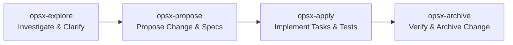

# AGENTS.md — Standing Context for Campus Giveaway

Welcome to the **Campus Giveaway** repository. This document defines the permanent project context, architectural decisions, technical stack, mobile-first design constraints, engineering conventions, and workflows for all human and AI agents working in this codebase.

---

## 1. Product Overview

- **Product Name**: Campus Giveaway
- **Mission**: Enable students graduating or moving out of Rensselaer Polytechnic Institute (RPI) to post items (free or cheap) so other students can claim them.
- **Core Values**: Campus sustainability, reducing waste, and helping juniors/underclassmen furnish and equip their dorms and apartments affordably.

---

## 2. Architecture & Technology Stack

> **Strict Constraint**: Do not deviate from this stack without formally proposing and approving an OpenSpec change.

### Frontend
- **Location**: `/frontend`
- **Framework**: Angular 20
- **Architecture**:
  - Standalone components only (no NgModules).
  - Angular Signals for reactive state management.
  - Modern built-in control flow syntax (`@if`, `@for`, `@switch`).
  - `ChangeDetectionStrategy.OnPush` across all components.
  - Reactive Forms for all form state handling and validation.
- **Styling**:
  - Plain SCSS following the design tokens in [design/DESIGN.md](design/DESIGN.md) and screen exports in [design/stitch/](design/stitch/).
  - **Angular Material is NOT used**. Maintain custom, lightweight, mobile-tailored SCSS.

### Backend
- **Location**: `/backend`
- **Language & Runtime**: Java 21
- **Framework**: Spring Boot 3.5, Maven build system
- **Core Modules**:
  - Spring Web (`@RestController`, RESTful APIs)
  - Bean Validation (`jakarta.validation.*`)
  - Spring Data JPA (PostgreSQL) and Spring Cloud GCP Cloud Storage
  - Auth: email/password (BCrypt, HS256-signed session tokens) and Google Sign-In (ID tokens verified against Google's keys)
- **Base Package**: `edu.rpi.giveaway`

### Data & Cloud Infrastructure
- **Database**: PostgreSQL 17 — Docker locally (`docker compose up -d`, port 5433), Cloud SQL in production.
- **Blob / Media Storage**: Google Cloud Storage (GCS) bucket for item photos.
- **Local Development**: Postgres in Docker, photos on local disk (`backend/uploads/`), secrets in the git-ignored `.env` (see `.env.example`).
- **GCP Region**: `us-east1`.
- **Single Deployable Architecture**:
  - The Angular production build is copied into Spring Boot static resources (`/backend/src/main/resources/static/`).
  - Packaged and deployed as a single unified container on Google Cloud Run.

---

## 3. Mobile-First Principles

Most users arrive by scanning a physical QR code on campus fliers using their smartphone. Mobile usability is the primary design benchmark.

- **Viewport Constraints**:
  - Design for **360px – 430px** width first.
  - Scale up progressively for tablets and desktops using `min-width` media queries.
- **Touch & Ergonomics**:
  - All interactive touch targets must be **≥ 48px × 48px**.
  - Primary actions must live in a sticky bottom bar within easy thumb reach.
  - Zero hover-only interactions (all features must be explicitly discoverable and actionable via touch).
- **Camera & File Capture**:
  - Photo input must use `<input type="file" accept="image/*" capture="environment">` to trigger the mobile rear camera directly.
  - Resize photos client-side to a maximum dimension of `≤ 1600px` before uploading to conserve bandwidth and reduce upload latency.
- **Keyboards & Input Experience**:
  - Use semantic input types (`type="email"`, `type="tel"`, `inputmode="numeric"`, `inputmode="decimal"`) to automatically bring up the relevant mobile keyboard layout.
- **PWA & Performance**:
  - Installable Progressive Web App (valid web app manifest, app icons, service worker).
  - Google Lighthouse mobile performance score target: **≥ 90**.

---

## 4. Engineering & API Conventions

### REST & API Standards
- Endpoints live under `/api/**`.
- JSON payloads exclusively.
- ISO-8601 UTC timestamps (e.g., `2026-10-23T05:07:50Z`).
- Strict separation between DTOs (Data Transfer Objects) and persistence models (JPA entities / documents). Never expose persistence models directly over HTTP.

### Privacy & Security
- **Poster Contact Privacy**: Contact information (email, phone, exact room number) of posters is **NEVER** returned by public list, search, or item detail endpoints. Contact details are only surfaced through interest notifications directed to the poster.
- **Zero Hardcoded Secrets**: No API keys, credentials, or secrets in source code. Configuration must come via environment variables or Google Secret Manager.

### Testing Standard
- **100% Spec Coverage**: Every requirement documented in [openspec/specs](openspec/specs) must have at least one automated test.
  - Backend: JUnit 5, AssertJ, and Spring `MockMvc` / `@WebMvcTest` / `@SpringBootTest`.
  - Frontend: Jasmine/Vitest component and service tests.
- Run tests and verify zero failures before marking any task complete.

### Accessibility (a11y)
- Target: **WCAG 2.1 Level AA**.
- Every form field must have an associated explicit `<label>`.
- Fully navigable and operable via keyboard and assistive technology.
- Sufficient color contrast ratios matching the brand palette in [design/DESIGN.md](design/DESIGN.md).

### Git & Source Control
- Follow the [Conventional Commits](https://www.conventionalcommits.org/) specification (`feat:`, `fix:`, `docs:`, `style:`, `refactor:`, `test:`, `chore:`).

---

## 5. OpenSpec Workflow

This repository strictly uses the OpenSpec specification-driven development workflow:

- **Never write code for a new capability without an OpenSpec change**:
  1. **Explore**: Investigate problems, brainstorm, and clarify requirements (`/opsx-explore`).
  2. **Propose**: Generate proposal, delta specs, and tasks (`/opsx-propose`).
  3. **Apply**: Implement tasks incrementally, running tests after each step (`/opsx-apply`).
  4. **Archive**: Sync delta specs to main specs and archive (`/opsx-archive`).
- **Source of Truth**: [openspec/specs](openspec/specs) is the single source of truth for the system's behavior.

---

## 6. Definition of Done (verification gate)

A change is done only when the verification agent has passed it:

1. `/opsx-apply` completes every task in `tasks.md`.
2. The verification agent (`.agents/skills/change-verifier`, or `@verifier` in OpenCode) maps every spec scenario to a test and runs `scripts/verify.sh`: OpenSpec validate → backend tests → frontend tests → production build → Playwright end-to-end.
3. It writes `openspec/changes/<change>/verification.md`.
4. Only then commit. The `.githooks/pre-commit` hook re-runs the gate for any commit touching `backend/` or `frontend/`. **Never use `git commit --no-verify`.**
5. Then `/opsx-archive`.
