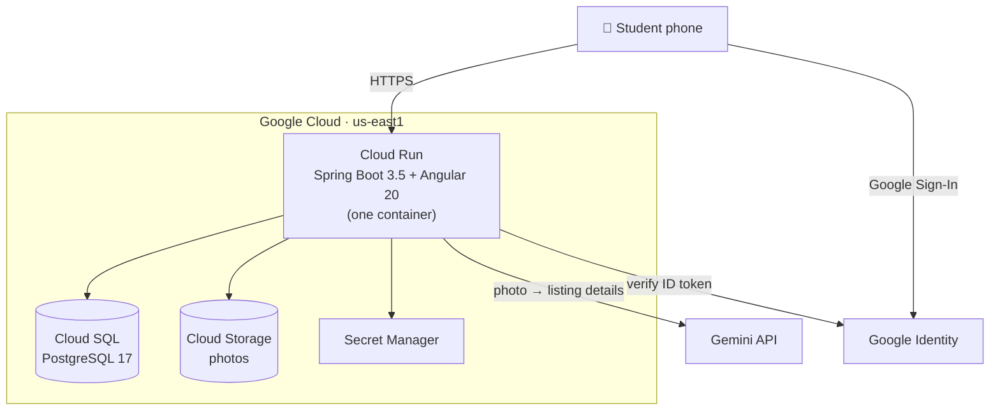

# Campus Giveaway: a spec-driven development demo

**Moving out of Troy? Pass it on.** Campus Giveaway is a mobile-first web app where RPI students who are leaving campus
post desks, mini-fridges, textbooks and bikes, free or cheap, and other students say *"I'm interested, I'll pick it up."*

It was built for the talk **"Stitching the Future of Coding: Autonomous AI Agents & Spec-Driven Development with
Google Antigravity, Gemma, and Gemini"** at **DevFest Troy 2026 (GDG Hudson)**. The app is the demo. The real subject
is *how* it was built: **specs first, agents second, verification always.**

---

## Why this repo exists

Vibe coding gets you an output. Spec-driven development gets you a system you can still change next week.

| | Vibe coding | Spec-driven development |
|---|---|---|
| Starting point | A prompt | A reviewed spec (`openspec/specs/`) |
| Where decisions live | A chat window you closed | Markdown in the repo, versioned in git |
| Changing existing code (brownfield) | The agent guesses why things are the way they are | The agent reads the spec and proposes a **delta** |
| "Done" means | It looks like it works | Every scenario has a test, and the verification gate passes |

Every feature here went through **Explore → Propose → Apply → Archive** with [OpenSpec](https://github.com/Fission-AI/OpenSpec).
The history of decisions is in [`openspec/changes/archive/`](openspec/changes/archive/).

---

## What's inside

- **Sign in, then photo, then AI fills in the listing.** Students sign in, snap a photo, and **Gemini** reads it and fills in
  the title, category, condition, price and description. They review and post.
- **Accounts:** email + password (BCrypt, signed and expiring session tokens) or **Google Sign-In** (ID tokens verified
  against Google's keys). The admin account is seeded from environment variables and is never in code.
- **Customizable feed:** Grid / List layout, comfortable or compact cards, and sorting, all remembered per device.
  Mobile-first (built for students scanning a QR code).
- **Privacy:** a poster's email or phone is never returned by public endpoints.
- **Verification gate:** a git pre-commit hook runs specs → backend tests → frontend tests → production build → Playwright end-to-end.

## Architecture



| Layer | Tech |
|---|---|
| Frontend | Angular 20 (standalone components, signals, OnPush), SCSS design tokens from [Stitch](https://stitch.withgoogle.com) designs in [`design/`](design/) |
| Backend | Java 21, Spring Boot 3.5, Spring Data JPA, Bean Validation |
| Data | PostgreSQL 17 (Docker locally, Cloud SQL in prod), Cloud Storage for photos |
| AI | Gemini 2.5 Flash (photo → listing), Gemma via Ollama for local, offline agent work |
| Infra | Terraform ([`infra/terraform`](infra/terraform)), Cloud Build, Cloud Run ([`deploy.sh`](deploy.sh)) |
| Agents | Google Antigravity + `agy` CLI, OpenCode + local Gemma, OpenSpec workflows in [`.agents/`](.agents/) and [`.opencode/`](.opencode/) |

## Quick start (local)

Prerequisites: Java 21+, Node 22+, Docker.

```bash
cp .env.example .env          # add your Gemini key (https://aistudio.google.com/apikey) and an admin email/password
docker compose up -d          # PostgreSQL on localhost:5433
```

```bash
cd backend && ./mvnw spring-boot:run      # API on http://localhost:8080 (reads ../.env automatically)
```

```bash
cd frontend && npm install && npm start    # app on http://localhost:4200
```

Sign in with the admin account from your `.env`, or register a student account.

## The spec-driven workflow

```
openspec/
├── specs/                  # what the system does TODAY (source of truth)
├── changes/                # proposed deltas waiting to be applied
│   └── archive/            # applied changes: the history of decisions
└── config.yaml             # rules every proposal and task list must follow
AGENTS.md                   # standing context for every agent in this repo
```

```bash
npm install -g @fission-ai/openspec@latest
```

Then, in your agent (Antigravity, OpenCode, Gemini CLI, Claude Code…):

| Command | What happens |
|---|---|
| `/opsx-explore` | Think with the agent. It reads the specs and code. **No code yet.** |
| `/opsx-propose <name>` | The agent writes a proposal, a design, tasks and **spec deltas** (ADDED / MODIFIED). You review them. |
| `/opsx-apply <name>` | The agent implements the tasks one by one, running tests as it goes. |
| `/opsx-archive <name>` | The deltas merge into `openspec/specs/`, and the change moves to the archive. |

The prompts used to design and build this app are in [`docs/prompts/`](docs/prompts/).

## Verification gate

```bash
scripts/verify.sh          # full: specs, backend tests, frontend tests, build, Playwright e2e (app must be running)
```

```bash
scripts/verify.sh quick    # everything except e2e
```

Turn on the pre-commit hook once per clone, so code commits are blocked unless the gate passes:

```bash
git config core.hooksPath .githooks
```

The Playwright suite ([`.agents/skills/playwright-e2e-verifier`](.agents/skills/playwright-e2e-verifier)) checks, among other things,
that the feed never scrolls sideways on a phone, that poster contact info never appears, that forged admin tokens are rejected,
and that the full **sign in → photo → Gemini → post** flow works.

## Try it yourself: add moderation

Right now anyone signed in can post anything. Add admin moderation the spec-driven way:

```
/opsx-explore New posts should be approved by an ADMIN before they appear in the public feed.
Which existing requirements change? What new states does a post need? What are the risks?
```
```
/opsx-propose post-moderation
```

Review the spec delta (look for **MODIFIED** requirements), then `/opsx-apply`, then run `scripts/verify.sh`, then `/opsx-archive`.
Bonus: let a small local model (Gemma via Ollama in OpenCode) implement a well-specified change like **dark mode**.
The colors are already CSS custom properties in [`frontend/src/styles.scss`](frontend/src/styles.scss).

## Deploying to Google Cloud

[`infra/terraform`](infra/terraform) provisions Cloud SQL, the photo bucket, Secret Manager, Artifact Registry and a least-privilege
service account. [`deploy.sh`](deploy.sh) builds with Cloud Build and deploys to Cloud Run. In production, set `AUTH_TOKEN_SECRET`,
`ADMIN_EMAIL`, `ADMIN_PASSWORD`, `ADMIN_EMAILS`, `GEMINI_API_KEY` and `GOOGLE_CLIENT_ID` through Secret Manager. Never commit them.

---

Built live with AI agents, reviewed by a human, and verified by tests. *Specs first, agents second, verification always.*
